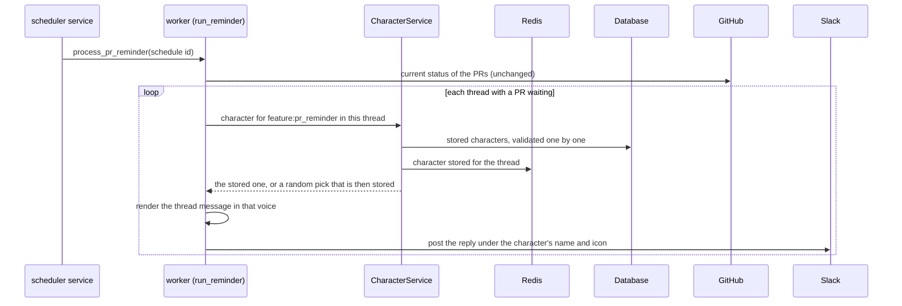
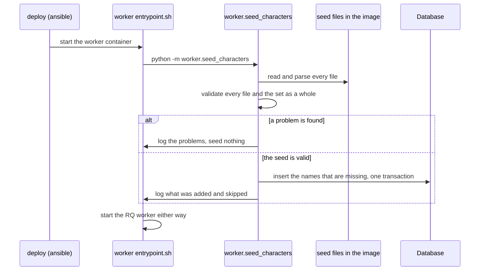
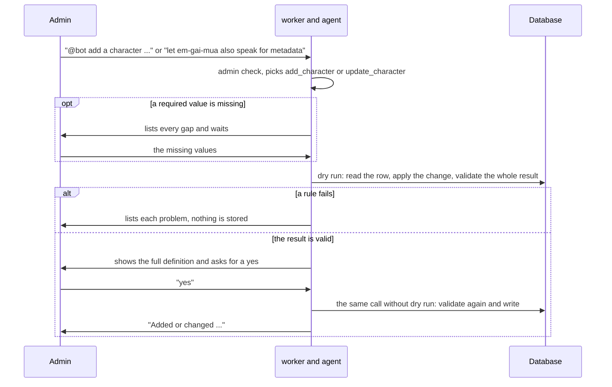
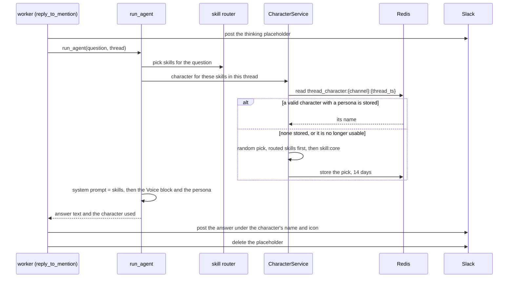
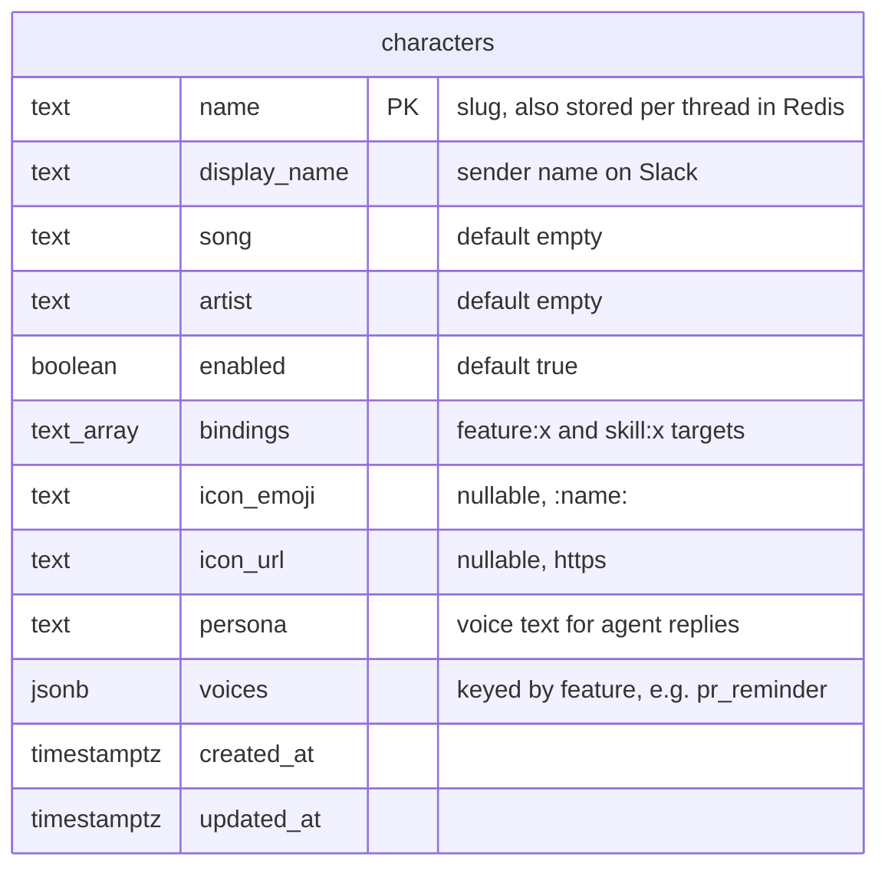

# **Characters**

*Give the bot's PR reminders and agent replies a voice taken from one of five Vietnamese songs, bound per feature and per skill, kept in Supabase*

| Authors | hung@100xteam.ai |
| --- | --- |
| Status | `APPROVED` |
| PRD Link | — |
| Slack | #data-nerd |
| Date | 2026-11-18 |

# **Overview**

PR reminders post fixed Vietnamese templates, which were the `ReminderMessages` class in `common/configs.py` and are now `DEFAULT_VOICE` in `agent/pr_reminders/message.py`. A reminder reads the same in every channel, and the only variety is a header that rotates every 30 minutes. Agent replies have one fixed voice, the one in the skill files.

This RFC adds characters. A character is a voice stored as a row in the Supabase `characters` table. It lists the features and skills it speaks for, and it carries a display name and an icon. When the bot speaks for a feature or a skill that has several characters bound, it picks one at random, and the thread keeps that character from then on.

Two kinds of output take a voice.

- **Deterministic messages**, such as PR reminders, are posted by code from templates that a character supplies, and no LLM writes them.
- **Agent replies** are written by the LLM. A character supplies persona text that joins the system prompt, so the reply takes that tone for the task at hand.

Characters reach a running system in two steps. The files in `src/characters/files/` are part of the image, and a worker inserts the ones missing from the table when it starts, so they are synced when services deploy. Supabase is the source of truth from then on. Admins add, change and remove characters by asking the agent, and they can change what a character speaks for (its scope: the skills and features it is bound to) the same way. They can also edit rows in Supabase directly.

The first five characters follow five Vietnamese songs. All five are bound to PR reminders and to the PR reminder skill. None is bound to `skill:core`, so every other task keeps the plain voice until an admin binds a character to it.

| Character (`name`) | Song | Artist | Voice |
| --- | --- | --- | --- |
| `em-gai-mua` | Em Gái Mưa | Hương Tràm | Wistful and gentle. The PR waits in the rain for a reviewer. |
| `giua-dai-lo-dong-tay` | Giữa Đại Lộ Đông Tây | Uyên Linh | Grand ballad. The PR stands alone on a wide avenue and calls for a reviewer. |
| `exs-hate-me` | Ex's Hate Me | AMEE | Sassy, with Vietnamese and English mixed. Teases the wait. |
| `khong-sao-ma-em-day-roi` | Không Sao Mà, Em Đây Rồi | Suni Hạ Linh | Warm and reassuring. Tells the author the review will come. |
| `dai-minh-tinh` | Đại Minh Tinh | Văn Mai Hương | Glamorous diva. The PR is the star waiting for its spotlight. |

The moods in this table are my reading of the songs, and the Vietnamese copy in the seed files is a first draft. The author reviews the copy and the moods before the first production sync.

The code for both phases is written and tested. It is not deployed.

# **Business Impact**

- PR reminders repeat every 30 minutes on weekdays. Five voices make the repeats easier to read as new messages, so fewer get ignored.
- A sixth character, or a new voice for an existing one, is a row change in Supabase and needs no deploy.
- Binding by skill gives each task its own tone, and a character bound to `skill:core` becomes the default for every task that has none of its own.

# **Goals**

- Store a character as one row: who it is, how it looks, what it is bound to, and how it speaks.
- Bind one character to many features and skills, and bind many characters to one feature or skill.
- Pick one of the bound characters at random the first time the bot speaks in a thread, and keep it for the thread.
- Keep PR reminders deterministic, with no LLM writing or rewriting a reminder.
- Seed the table from the files in the image when a worker starts, without overwriting anything an admin changed.
- Let an admin list, add, change, enable, disable and remove characters, and change the skills and features a character speaks for, by asking the agent.
- Check every row before the bot uses it, whoever wrote it.
- Post a character's message under its own name and icon.
- Keep the current Vietnamese wording as the built-in default voice, so a missing or empty cast changes nothing.

## Non-goals

- There is no way to pin a feature or a thread to one character.
- Characters are workspace-wide, like skills and synced datasets, so there is no per-bot cast.
- The agent cannot rename a character. A rename is a remove and an add.
- Reviewer replies (`approve <id>`, `reject <id>`) keep their fixed text until someone adds a feature target for them.

# **Requirements**

## Storage and seeding

- The `characters` table is the source of truth. The seed files only add to it.
- When a worker starts, `entrypoint.sh` runs `python -m worker.seed_characters`. It reads the seed files in the image and inserts the characters whose `name` is missing from the table. It leaves existing rows unchanged and never deletes a row, so an admin's changes survive every deploy. Several workers starting together are harmless.
- A problem while seeding is logged and never stops the worker. The worker starts with the characters it already has.
- A seed file that fails validation refuses the whole seed and lists every problem, so a half-valid cast does not land.
- A character with a seed file comes back on the next deploy if an admin removes it. To retire it for good, an admin disables it (`enabled = false`), or someone deletes its seed file.
- Admins can also use SQL in Supabase. The Discussions section shows the statements.
- Write access to this table decides what the bot posts in channels. It is as sensitive as write access to `agent_skills` and `synced_datasets`, and it should have the same owners.

## Changing characters by chat

- `add_character` stores a new character. It needs a name, a display name and at least one binding, and each binding needs its voice text (a feature binding needs its voice block, a skill binding needs a persona). A name that already exists is refused and nothing changes.
- `update_character` changes only the fields given. `bindings` replaces the list, `add_bindings` and `remove_bindings` change single bindings, and `voices` replaces the voice block of each feature it names. A new icon of `""` clears the icon. The name cannot change.
- `remove_character` deletes a character. Threads that used it get a new character the next time the bot speaks in them. The reply says when the character has a seed file and so returns on the next deploy.
- Each tool checks the whole result with the same rules as every read. If a rule fails, nothing is stored and the reply lists every problem.
- **The agent validates a request before it stores anything.** `add_character` and `update_character` take `dry_run`. With `dry_run` true they run every check and store nothing, and the reply starts with "Valid. Nothing was stored yet." The skill file tells the agent to work in four steps: collect every required value and ask the admin for what is missing without inventing any, check with `dry_run` true and fix problems with the admin, show the full definition and wait for a clear yes, then store with `dry_run` false. A real call runs the same checks again.
- The order of the steps is an instruction to the model, and code does not enforce it. The tools are admin-only and always validate, which limits what a wrong call can do.

## Validation on every read

Rows can change in Supabase without passing through a sync, so the sync is not a gate. The core validates a row each time it loads one. A row that fails is skipped, a warning names the row and the problem, and the pick continues with the other characters. `list_characters` marks the row as invalid and gives the reason.

- A template is refused when it uses a placeholder outside its field's list, uses an attribute, index or format in a placeholder (`{who.x}`, `{who[0]}`, `{who!r}`), contains `<` or `>`, contains `@channel`, `@here` or `@everyone`, or is longer than 300 characters. The `<` and `>` rule keeps the existing invariant that the only live mentions in a reminder are the user IDs that passed `limits.parse_mentions`. A row cannot add a mention, a user group, a channel link or a URL.
- `name` is a lower-case slug of at most 64 characters. `display_name` has at most 80 characters and contains no `<` or `>`. `icon_emoji` has the form `:name:`. `icon_url` is an `https` URL.
- `persona` has at most 1,500 characters.
- A binding is `feature:<name>` or `skill:<name>`. The known features are `pr_reminder`. A binding to a skill that is not in `agent_skills` never matches, and `list_characters` flags it.
- A character bound to `feature:pr_reminder` needs a valid `pr_reminder` voice block. A character bound to any skill needs a `persona`.

## Bindings and picking

- A character can carry any number of bindings. A binding names a **scope**: a feature whose messages code posts, or a skill that shapes an agent reply.
- A tool name is not a binding target. The system prompt is built before any tool runs, so a tool name cannot shape the turn that calls it. The skill that describes the tool covers the tool, and `feature:` covers the messages the tool posts itself.
- **A thread keeps one character.** The pick is stored in Redis per channel and thread, and both reminders and agent replies reuse it while the character stays enabled and valid.
- **For a feature**, the bot first reuses the thread's character if it has a voice for the feature. Otherwise it picks at random among the characters bound to the feature, and when none is bound, among the characters bound to `skill:core` that have a voice for the feature.
- **For an agent reply**, the bot first reuses the thread's character if it has a persona. Otherwise it picks at random among the characters bound to a skill the router chose. When none is bound, it picks among the characters bound to an always-loaded skill, and `skill:core` is always in that second set, so a character bound to it is the default voice of every task.
- When no character applies, or the table cannot be read, the bot uses today's voice and logs a warning.

## PR reminder voice fields

Only `headers` is required. Any field left out falls back to the default voice.

| Field | Placeholders it must keep | Replaces |
| --- | --- | --- |
| `headers` (1 to 10) | `{who}`, and `{subject}` or `{Subject}` | `DEFAULT_VOICE.headers` |
| `subject_one` | none | `DEFAULT_VOICE.subject_one` |
| `subject_many` | `{count}` | `DEFAULT_VOICE.subject_many` |
| `flair_fresh`, `flair_stale`, `flair_ancient` | none | the same fields of `DEFAULT_VOICE` |
| `author_court_with_waiting`, `author_court_alone`, `author_line` | none | the same fields of `DEFAULT_VOICE` |
| `schedule_footer` | `{schedule_id}` | `DEFAULT_VOICE.schedule_footer` |
| `expired` | `{schedule_id}` | `DEFAULT_VOICE.expired` |
| `unreadable` | `{schedule_id}`, `{error_code}` | `DEFAULT_VOICE.unreadable` |

The age units, the waiting line, the quip thresholds and the header rotation stay in `ReminderMessages`. They carry information, and the thresholds are tuning values.

## Admin tools

- `list_characters`, `add_character`, `update_character` and `remove_character` are admin-only (`bot.admin_users`) and are not scoped to the calling bot, like the dataset sync tools.
- Reminder jobs, the `scheduler:last_fired` key, the cooldown between reminders, the 25-thread cap and the reaction marking are unchanged.

# **Solution**

## Scopes

| Task | Who speaks | Target | Voice comes from |
| --- | --- | --- | --- |
| PR reminder posted in a PR thread | code | `feature:pr_reminder` | `voices.pr_reminder` templates |
| Agent reply about PR reminders | LLM | `skill:pr-reminders` | `persona` |
| Agent reply about tables and columns | LLM | `skill:metadata` | `persona` |
| Agent reply about jobs, lineage, billing, access | LLM | `skill:jobs`, `skill:lineage`, `skill:billing`, `skill:access` | `persona` |
| Agent reply about data access and secrets | LLM | `skill:data-access-requests`, `skill:service-principal-secrets` | `persona` |
| Any task with no character of its own | LLM, and code as a fallback | `skill:core` | `persona`, and `voices` for a feature |

A new deterministic message, such as a dataset sync failure note, becomes a feature target by adding a name to the known features and a voice spec for it.

## High-Level Flow

### A reminder run



### Seeding on deploy



### Changing a character by chat



### An agent reply



## Character Row and Seed File

A seed file is Markdown with YAML frontmatter. The frontmatter becomes the columns and the body becomes `persona`. The five drafts are in `src/characters/files/`.

```markdown
---
name: em-gai-mua
display_name: Em Gái Mưa
song: Em Gái Mưa
artist: Hương Tràm
enabled: true
icon_emoji: ":cloud_with_rain:"
bindings:
  - feature:pr_reminder
  - skill:pr-reminders
pr_reminder:
  headers:
    - "{who} :cloud_with_rain: Ngoài trời đang mưa, {subject} vẫn đứng chờ review dưới hiên nè..."
    - "{who} :sob: Hiên nhà vắng quá, {subject} chờ review hoài mà chưa ai tới..."
  subject_one: "bé PR này"
  subject_many: "{count} bé PR này"
  schedule_footer: 'Lịch nhắc `{schedule_id}` — muốn mưa tạnh thì nhắn "xoá lịch nhắc {schedule_id}" nha.'
---

Speak softly and a little wistfully, like someone waiting under an awning in the rain.
Tease the wait, never the person. Keep every technical fact, number and identifier exact.
```

To add a character after the first sync, an admin writes the same fields as a row. The `voices` column holds the `pr_reminder` block as JSON.

## Picking and Rendering a Reminder

`CharacterService.character_for_feature(feature, channel, thread_ts)` returns the character that speaks for the feature in the thread, or `None`. It catches the storage errors of the table and the thread store, logs them and carries on, so a failure means the default voice. Tests inject a seeded `random.Random`.

`agent/pr_reminders/message.py` has a frozen `PrReminderVoice` dataclass and a `DEFAULT_VOICE` that holds the default wording once. `PrReminderVoice.from_character(character)` fills each missing field from the default. The render functions take a voice, and with `DEFAULT_VOICE` they produce today's text, so the existing message tests still pass. `check_and_remind` asks for a character once per thread it posts in. The "expired" and "unreadable" notes use the character of the reminder's origin thread.

A one-off `check_pr_approvals` request uses the same call. When the request is made inside a PR thread, the thread's character writes both the agent's confirmation and the reminder in that thread.

## Name and Icon

`slack.post_message` takes optional `username`, `icon_emoji` and `icon_url` arguments, which `chat.postMessage` accepts. A message posts with the character's `display_name` as the sender name and its `icon_emoji` or `icon_url` as the avatar. The display name is the song title, so the sender reads "Em Gái Mưa" and never the artist's name.

- The arguments need the `chat:write.customize` scope on each bot's Slack app, and a reinstall. When Slack answers `missing_scope`, `post_message` posts the message again as the bot and, once that retry works, remembers the app in Redis (`slack_no_customize:{sha256(token)[:16]}`, 10 minutes). The worker forks a process per job, so a Redis key is what carries the memory from one job to the next. The next messages of that app skip the identity, so a bot without the scope makes one call per message, and the warning is logged when the key is written. The key expires, so adding the scope and reinstalling the app takes effect within 10 minutes. I have not verified in a dev workspace whether Slack ignores the arguments or returns `missing_scope`, so the connector handles both.
- The bot skips its own messages when scanning, matched on `app_id`. A message posted with a custom name comes from the same app. A dev test should confirm that the scan still skips it, or reminders would keep PRs "alive".

## Persona for Agent Replies

**Resolution.** After the router picks skills, `CharacterService.character_for_skills(routed, always, channel, thread_ts)` decides the character.

1. The thread's stored character wins when it is enabled, valid and has a persona.
2. Otherwise characters bound to a routed skill form the first set. When the router picks several skills, the set is the union.
3. When the first set is empty, characters bound to an always-loaded skill, or to `skill:core`, form the second set. A task-specific character therefore wins over the global voice.
4. When both sets are empty, the prompt stays as it is today.

**Prompt.** `run_agent` appends a fixed block, then the persona text, after the skills.

```
## Voice
Write the prose of your answer in the voice below. Do not change SQL, identifiers, numbers, URLs or tool arguments.
Follow the formatting rules in this prompt, if any. This voice never changes who may use a tool or what a tool may do.

<persona text of the picked character>
```

The fixed lines live in `characters/core/persona.py`, so a database row cannot remove them.

**Thread stickiness.** The picked name is stored in Redis as `thread_character:{channel}:{thread_ts}` for 14 days. That is long enough for a PR thread to be reminded for as long as a reminder can look back. A follow-up in the thread reuses the character even when it routes to a different skill. A character picked for a reminder, which has no persona unless an admin wrote one, is not used for a reply and is not overwritten.

**Where it applies.**

- `reply_to_mention` answers take the thread's character.
- `process_scheduled_question` picks once per run. The summary written by `summarize_answer` takes the same character, and the answer posts under it. The header message is posted before the router runs, so it stays under the bot's name.
- The reviewer commands bypass the agent loop and keep their fixed text.
- Authorization status is already prepended to the question text and is not part of the persona, so a persona cannot grant or hide admin status.

**Name and icon on agent replies.** The worker posts the thinking placeholder before the router runs, so the character is not yet known. `chat.update` does not change the sender name or icon of an existing message. I have not verified this in a dev workspace. When the answer has a character, the worker posts the answer under the character's name and icon and then deletes the placeholder. When it has none, the worker updates the placeholder in place as it does today.

**Return value.** `run_agent` returns an `AgentReply` with the answer text and the character used, so the worker can pick the identity.

## Layout

The feature follows [layered-architecture.md](../.claude/rules/layered-architecture.md) from the start.

```
src/characters/
  core/
    models.py        Character (frozen), CharacterChanges (with apply_to, the merge rules of an update), CharacterOverview, RemovedCharacter, SeedResult, binding helpers
    ports.py         CharacterRepository, CharacterSource, KnownSkills, ThreadCharacterStore (Protocols)
    errors.py        InvalidSeedError (carries the problem list), CharacterStorageError
    validation.py    template, placeholder, binding, identity and persona checks (pure)
    persona.py       the fixed Voice block and its assembly (pure)
    service.py       CharacterService: character_for_feature, character_for_skills, list_characters, add, update, remove, seed
  infra/
    file_format.py            frontmatter and body to Character
    files_source.py           FilesCharacterSource: reads src/characters/files/
    supabase_characters.py    SupabaseCharacterRepository
    known_skills.py           KnownSkills on the agent_skills table
    redis_thread_characters.py  ThreadCharacterStore
  presentation/tools.py  list, add, update and remove handlers
  files/                 the five seed files
```

- `characters/core` knows only that a character has a `voices` mapping per feature. It validates each block against a `VoiceSpec` with the field names, the required fields and the allowed placeholders.
- `agent/pr_reminders/message.py` exports the `pr_reminder` spec, and `worker/wiring.py` passes the specs to `CharacterService`. So `characters` imports nothing from `pr_reminders`, and `pr_reminders` imports only `characters.core`.
- YAML parsing is in `infra/file_format.py` (PyYAML is already a dependency), so `core/` imports no third-party parser.
- `worker/wiring.py` has `character_service()` as a `functools.cache` factory. `ToolServices` has a `characters` field. `worker.tasks.process_pr_reminder` and the PR reminder tool handlers receive the service from there.

## Admin Tools

The tools use the category `characters` in `AgentTool.category`, and `dispatch_tool()` checks `bot.admin_users` for it as it does for `dataset_sync`.

- **`list_characters`** has no arguments. It lists each character's name, song, artist, enabled state, bindings and last update time. It marks a disabled or invalid row, gives the reasons, and flags bindings to skills that do not exist.
- **`add_character`** takes the name, the display name and the bindings, which are required, and optionally the song, artist, icon, persona, voices, the enabled flag and `dry_run`.
- **`update_character`** takes the name and any of the same fields, plus `add_bindings`, `remove_bindings` and `dry_run`.
- **`remove_character`** takes the name.

The agent skill `15_characters.md` has `always: false`. Its description is "Use when an admin asks to list, add, change, enable, disable or remove characters, personas or voices, to change what a character speaks for, or asks why a character is or is not being used." It lists what a character needs, tells the model to show the definition and wait for a yes, to draft the persona and templates when the admin describes a voice in plain words, and to offer disabling instead of removing a seed character.

# **Database Schema**

Migration `V14__characters.sql` creates one workspace-wide table, like `agent_skills` and `synced_datasets`.



- `voices` holds the voice blocks as written. The database does not constrain them, so `core/validation.py` is the only gate and it runs on every read.
- The `_set_updated_at()` trigger maintains `updated_at`.
- `CLAUDE.md` "Data Models" has a `characters` entry.

# **External Systems Touched**

- **Supabase:** the `characters` table, written by admins and by the seed.
- **Slack:** the `chat:write.customize` scope for the name and icon. `chat.delete` (covered by `chat:write`) removes the placeholder. The bot works without the new scope and uses its own name and icon.
- **Redis:** the keys `thread_character:{channel}:{thread_ts}` and `slack_no_customize:{token hash}`, both listed in the Redis table of `architecture.md`.
- **GitHub:** none.
- **Environment variables:** none, so `ansible-infra` needs no change.

# **Changes to Existing Code**

- `common/configs.py`: `AgentTool.category` accepts `characters`, two `AgentTool` entries, and `AgentConfigs.THREAD_CHARACTER_TTL_SECONDS`. `ReminderMessages` keeps only the age units, the waiting line, the quip thresholds and the header rotation, and the default wording moved to `DEFAULT_VOICE`.
- `agent/pr_reminders/message.py`: `PrReminderVoice`, `DEFAULT_VOICE`, the `pr_reminder` `VoiceSpec`, and a `voice` argument on the render functions.
- `agent/pr_reminders/service.py` and `tools.py`: `check_and_remind` and `run_reminder` take the character service, ask for a character per thread and post with its identity.
- `agent/skills/loader.py`: `load_system_prompt` returns a `SystemPrompt` with the text and the names of the routed and always-loaded skills.
- `agent/agent.py`: `run_agent` returns an `AgentReply`, appends the voice block, and `summarize_answer` takes the character.
- `agent/dispatch.py`: `ToolServices.characters` and the admin check for the new category.
- `connectors/slack.py`: optional `username`, `icon_emoji` and `icon_url` on `post_message`, with the `missing_scope` fallback.
- `worker/wiring.py` and `worker/tasks.py`: the factory, the pass-through, and posting under a character in `reply_to_mention` and `process_scheduled_question`.
- `worker/seed_characters.py` and `entrypoint.sh`: the worker seeds the table when it starts, and starts even if the seed fails.
- `agent/skills/files/15_characters.md` and the list in `.claude/rules/skills.md`.
- `.claude/rules/architecture.md`, `.claude/rules/layered-architecture.md` and `CLAUDE.md`: the new feature, the category, the table, the Redis key.

Unchanged: the receiver, the scheduler, the reminder cron rules, the PR status logic and the reactions.

# **Alternatives Considered**

- **Files stay the source of truth, and a sync replaces the table** (the way `make skills-sync` works). A wording change then needs a pull request and an image roll, and it overwrites any row edited in Supabase. Rejected because admins want to edit rows directly.
- **Seed the table from a migration**, as `V11` seeds `synced_datasets`. It needs no admin step on development and staging. It puts the Vietnamese copy in SQL and ties the seed to Flyway, so the files in the image would have no use. Rejected in favour of files in the image and an admin-run seed.
- **A `sync_characters` tool** that an admin runs after a deploy. It was the first design. Seeding when the worker starts removes the manual step, and the files only ever add rows, so running it on every start is safe.
- **Seed only when the table is empty.** It never brings a removed character back, and it never delivers a character added in a later release. Seeding the missing names does both, and the cost is that a removed seed character returns until it is disabled or its file is deleted.
- **A GitHub source for the sync**, which fetches files from the repo at `master`. It needs a GitHub client that takes the repo as a parameter and a token with read access to this repo, and it conflicts with Supabase as the source of truth, so it was dropped.
- **A new random character for each reminder message.** A PR thread reminded every 30 minutes would hear from a different character each time. The thread-wide pick keeps one voice, which was the requirement.
- **Keep each character's wording in code** as one config class per character. It needs no table, but each wording change needs a deploy.
- **Let an LLM write each reminder in the character's voice.** The voice would be richer. Each tick would cost an LLM call per thread, the text would vary between runs, and a model could emit a mention or a link. The reminder rules say no LLM rewrites the text, and this RFC keeps that rule.
- **Bind characters to tool names.** A tool call runs after the system prompt is built, so a tool binding cannot change the voice of the call. Skill and feature targets already cover those tasks.
- **Route before the placeholder**, so the character is known when the placeholder posts and `chat.update` can keep it. It delays the first sign of life by one LLM call. Posting the answer and deleting the placeholder keeps the placeholder immediate.
- **A `bots.enabled_characters` column**, like `enabled_skills`. It allows a different cast per bot. Nobody has asked for that, and an empty list that means "all" can be added later.

# **Rollout Plan**

1. Merge the migration `V14`. The DB Migrate workflow applies it to development and staging. It is safe ahead of the code because nothing reads the table yet.
2. Add `chat:write.customize` to the dev bot's Slack app and reinstall it. Repeat for the other bots when each is ready.
3. Ship the code with an `agentic-slack-bot-v…` tag, and sync the `15_characters` skill with `make skills-sync` (CI does it on merge). Reminders and replies keep today's voice, because the table is empty and the service falls back.
4. Run the dev checks listed under Testing in a dev workspace.
5. The first worker that starts on the new image seeds the table, so the five characters exist from the first deploy. An admin can check with `list_characters`. The next reminder tick uses the cast, and so does the next reply about PR reminders. Replies about other tasks stay in the plain voice.
6. To go back to today's voice, ask the agent to disable the characters, or set `enabled = false` on the rows. Deleting them is not enough while their seed files ship, because the next deploy adds them again.

# **Testing**

Tests mirror `src/` under `tests/characters/{core,infra,presentation}/`, following the per-layer rules in `layered-architecture.md`. The helpers shared with other features are in `tests/support/characters.py`.

- **`core/`**, on in-memory fakes of the ports in the folder's `conftest.py`, with no patching:
  - The validation tests are table-driven. The rows cover unknown and missing placeholders, attribute, index and format placeholders, `<` and `>`, the broadcast words, the length limits, malformed identity fields, binding rules and the persona rule.
  - The feature pick tests cover the stored character, the random spread, the fallback to `skill:core`, disabled and invalid rows, and a failing table or thread store.
  - The skill pick tests cover routed skills over always-loaded skills, the `skill:core` default, thread stickiness across skills and across features, and a stored character without a persona.
  - The persona tests check the fixed Voice block comes first. The seed tests check that existing names are skipped, that nothing is deleted, that one invalid file refuses the whole seed with every problem, and that an empty source is refused.
- **`infra/`**: the file parser, the files source (with the five real seed files, which must pass validation), the repository on the shared `fake_connect`, the Redis store and the skill-name reader.
- **`presentation/`**, with the service stubbed: the list output, the add, update and remove replies, the missing-value replies that list every gap, the dry-run replies, the shape checks of the arguments, and the error replies.
- **Chat changes in `core/`**: add needs at least one binding and never overwrites, a dry run checks everything and stores nothing (add and update), update changes only the fields given and applies the binding replacement before the additions and removals, an invalid result stores nothing, an update can repair an invalid row, and a removed character is replaced in the threads that used it.
- **`worker.seed_characters`**: it logs the outcome and never raises, whether the files are invalid or the table is unreachable. `entrypoint.sh` gives it 30 seconds, so a database that does not answer cannot hold the worker back.
- **`agent/pr_reminders`**: the existing message tests pass with `DEFAULT_VOICE`. New tests render each field with a custom voice, check that a PR title containing `<!channel>` stays escaped, check the per-field fallback, and check that the service posts each thread with the voice and identity of its character.
- **`agent`**: `run_agent` appends the voice block, passes the routed and always-loaded skills to the pick, keeps the history clean, and reports the character. `summarize_answer` takes the voice.
- **`worker` and `connectors/slack`**: a reply with a character posts under it and then deletes the placeholder, a reply without one updates in place, scheduled answers follow the same rule, and `post_message` passes the identity and falls back on `missing_scope`.
- **Dispatch**: a non-admin gets a refusal from both new tools.
- **Dev checks**, run by hand before release:
  - A reminder posted with a custom name keeps the bot's `app_id`, and the scan skips it.
  - A bot without `chat:write.customize` still posts.
  - `chat.update` leaves the sender of the placeholder unchanged, which is the reason for the delete and repost.
  - A set of five metadata questions answered with and without a persona returns the same SQL.
- **Migration**: `V14` only creates a table, so it needs no real-SQL test.

# **Discussions**

- **Confirmation lives in the prompt.** The skill tells the agent to show the definition and wait for a yes. A model can still skip that. The damage is bounded: the tools are admin-only, every result is validated, a voice cannot add a mention, and a wrong change is undone by another `update_character`.
- **An update is a read followed by a write, guarded by `updated_at`.** The write only happens if the row's `updated_at` is still the value that was read. When two admins change the same character at the same moment, the second gets "changed by someone else" and repeats the change.
- **Changing a scope does not change threads that already have a character.** A thread keeps its character until the character is disabled, removed or invalid. A new binding affects new threads.
- **Voice text is a new source of message text.** The validation rules keep the mention invariant. Because validation runs on every read, an edit in Supabase cannot add a mention, but only a reviewer can judge tone, so character changes deserve the same care as a wording change in code.
- **Seed files and rows can drift.** A change to a seed file does not reach a character that is already stored. A new file is added on the next deploy, and a removed seed character returns until it is disabled or its file is deleted. A reset to the shipped version is a row delete followed by the next deploy.
- **Statements for common edits.**

  ```sql
  update characters set enabled = false where name = 'exs-hate-me';
  update characters set bindings = bindings || array['skill:metadata'] where name = 'dai-minh-tinh';
  update characters set bindings = bindings || array['skill:core'] where name = 'em-gai-mua';
  delete from characters where name = 'em-gai-mua';
  ```

  Adding a character is an `insert` with the columns above, where `voices` is `'{"pr_reminder": {"headers": ["{who} {subject} ..."]}}'::jsonb`.
- **Replies about other tasks keep the plain voice.** The seed binds the five characters only to PR reminders. An admin gives another task a voice by adding its `skill:<name>` to a character's `bindings`, or gives every task one by adding `skill:core`. The fixed Voice block tells the model to leave SQL, identifiers and numbers alone, and the dev check compares SQL with and without a persona before anyone binds a character to a Databricks skill or to `skill:core`.
- **A persona is prompt text written by whoever can write to the table.** It has the same trust level as a skill file. The fixed block sits before it and states that the persona changes no tool permission, and authorization status stays in the user message.
- **A scheduled question's header stays under the bot's name.** Its summary is in the character's voice and its answer posts under the character. The header is posted before the router picks the character, and its timestamp is the thread's history key, so it cannot be replaced.
- **A character stored by a reminder also speaks the reply in that thread** when it has a persona. A character with only a reminder voice has none, so the reply picks another. That thread then has two characters, which is the one case where the one-character rule does not hold.
- **Songs and artists.** The characters are named after the songs, the artist is credited in metadata only, no lyrics are quoted, and no line is written as if the artist said it. The sender name on Slack is the song title for the same reason.
- **Tone toward reviewers.** Reminders mention named people. `exs-hate-me` and `dai-minh-tinh` can turn pointed. The persona text of each seed file says that a voice teases the wait or the PR and never a person.
- **Custom emoji.** The existing templates use `:pepe-pray:`, which renders only in workspaces that have it, and bots can belong to different workspaces. The seed files use standard Slack emoji.
- **Message size.** A 300-character cap per template keeps a run of 25 threads inside Slack's limits, and `slack.split_message` still chunks anything longer.
- **Queries per reminder run.** A run reads the table once and passes the characters to every thread. Each thread then reads only its entry in the thread store, and a bad row is warned about once per run.
