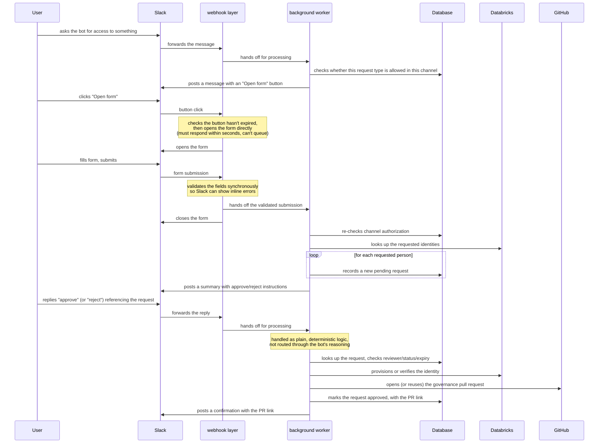
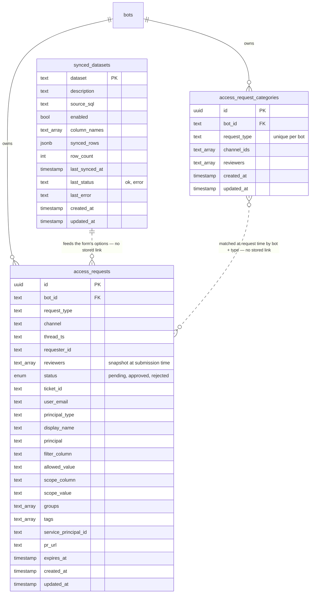

# **Data Access Request Form**

*Slack-native workflow for requesting, approving, and provisioning row-filter access to Databricks Unity Catalog data*

| Authors | hung@100xteam.ai |
| --- | --- |
| Status | `ADOPTED` |
| PRD Link | — |
| Slack | #data-access-requests |
| Date | 2026-09-12 |

# **Overview**

The data access request form lets a user request row-filter (or tag-scoped) access to Databricks data directly from a Slack conversation with the bot, without leaving Slack or filing a ticket by hand. The bot opens a form to collect the request details, validates and records the request, and — once a designated reviewer approves it — provisions the underlying identity in Databricks, appends the access rule to the data platform's governance configuration, and opens a pull request for sign-off.

This document describes the current implementation: the request form, the split between the always-on webhook layer and the background worker that handles it, the records that back it, and the review/approval flow that turns an approved request into a pull request.

# **Business Impact**

- Removes the manual, ticket-driven process for requesting row-level data access, cutting turnaround time from days to minutes.
- Keeps access grants auditable: every request and its resolution is a durable, timestamped record, and every approval produces a traceable pull request against the governance configuration.
- Reviewer authorization is scoped per request category (per Slack channel), so different data domains can have different reviewers without any code change — configured entirely as data.

# **Goals**

- Let any user request access to a defined category of data (today, row-filter access to a table) from within a Slack thread.
- Ensure only designated reviewers can approve or reject a request, and only for categories authorized in the channel where it was requested.
- Provision the underlying Databricks identity (a service principal or a user) and the corresponding governance pull request automatically on approval — no manual configuration editing.
- Keep the always-on webhook layer free of business logic, with only two narrowly-scoped, documented exceptions needed to satisfy Slack's own timing constraints.

# **Requirements**

- Must not require the requester to be an admin or otherwise whitelisted — any user in an authorized channel can start a request.
- Form field validation (email format, one email per line) must happen synchronously, so Slack can show inline form errors before the form closes.
- Channel-to-category authorization must be re-checked at every stage (button click, submission, approval), since that mapping can change between steps.
- A submission requesting multiple people must produce one independent request per person, so each can be reviewed and approved on its own.
- Approval must be safe to retry — re-approving an already-approved request must never duplicate the resulting pull request or its contents.
- The reviewer identity check must use the reviewer list captured for that specific request category, not the bot's general admin list — these are deliberately separate concepts.
- Requests must expire (24 hours) and an unopened form button must expire independently (1 hour), and both must be enforced without relying on the user not clicking late.

# Solution

## High-Level Flow



## Entry Point 1 — Requesting Access

- A user asks the bot for access in a Slack thread; the bot recognizes this as a data-access request.
- The bot checks whether the requested category is authorized for the channel it was asked in — if not, it declines politely with no side effects.
- If authorized, it reads the synced form-option datasets, stores a snapshot of the resulting dropdown options in Redis (kept as long as the button lives), and posts a message with a button. The button carries just enough context (which category, which channel/thread, who asked, who the eligible reviewers are, an expiry, and the token of the options snapshot) to open the right form later — nothing is recorded as a request yet.
- If a dataset the form needs has never been synced (or can't make a valid form), the bot declines without posting a button and says an admin must sync the data first.

## Entry Point 2 — Opening the Form

- Handled directly by the always-on webhook layer — one of two narrowly-scoped exceptions to "the webhook layer contains no business logic," because Slack requires the form to open within a few seconds of the button click, a latency guarantee an asynchronous background queue can't reliably provide.
- The webhook layer checks the button's expiry, attributes the request to whoever actually clicked it (not necessarily who it was originally posted for), loads the options snapshot from Redis, and builds the form. It reads no database: the worker already did that when it posted the button. A button with no snapshot (posted before this change, or whose snapshot expired) is treated as expired. The lookup has a one-second overall deadline, far inside Slack's three seconds; if Redis is slow or unreachable the click is acknowledged and logged, nothing is queued, and the user can simply click again.

## Form Fields

| Field | Type | Notes |
| --- | --- | --- |
| Ticket ID | free text | Used in the resulting PR title |
| User email(s) | free text (multiline) | One per line, no commas |
| Filter column | dropdown | Fixed: location, location market |
| Allowed value | dropdown | "ALL", a location (grouped by company) or a market code — **synced data** |
| Scope column | dropdown | Fixed: company key |
| Scope value | dropdown | One of the company keys — **synced data** |
| Principal type | dropdown | Currently only "Service principal" |
| Groups | multi-select | Fixed: groups to add the identity to |
| Tags | multi-select | Governance tags — **synced data** |

Fields marked **synced data** are not hard-coded: their options come from datasets copied from Databricks into the bot's database (see [Form Option Data](#form-option-data-synced-datasets)). Changing a location or tag needs no code change or deploy.

## Form Option Data (synced datasets)

The location, company and tag dropdowns used to be lists in the code, so every change meant a deploy. They now come from **synced datasets**: reference data copied from Databricks into Supabase on a schedule or on demand. We keep it in our own database so the bot never queries Databricks while someone is opening a form.

The sync is a generic module, not form-specific; any feature that needs slowly-changing reference data can register a dataset and read it.

| Dataset | Source query | Feeds |
| --- | --- | --- |
| `store_locations` | `company_key, company, location_market, location, id as location_id` from `vireox.ai_semantic.unified_dim_store_locations` | Allowed value (locations grouped by `company`, plus the distinct `location_market` codes) and scope value (distinct `company_key`) |
| `row_filter_tags` | the distinct 4th entry of `target_columns` in `system.information_schema.row_filters`, as `tag_name` | Tags |

### How a sync works

- **Full replace.** A sync re-runs the dataset's query and replaces the stored copy as a whole in one statement; there is no diffing or merging, so readers never see a half-written dataset.
- **Registry in Supabase.** The `synced_datasets` table holds one row per dataset: its name, description, the SQL, an enabled flag, the latest rows, and the outcome of the last attempt (`last_synced_at`, `last_status`, `last_error`, `row_count`). Adding a dataset is an INSERT, with no deploy. The SQL runs with the bot's Databricks token through a read-only guard (SELECT/WITH only, 50 s timeout), so write access to this table should be limited to the people who may already query Databricks through the bot.
- **One sync at a time.** The whole sequence (read the dataset's entry, run the query, check the result, replace the copy) runs under a per-dataset database lock. A manual and a scheduled sync can't overwrite each other, and the shrink check never compares against a stale row count. A second sync is refused rather than queued (a scheduled tick that finds one running does nothing).
- **Safe on failure.** A failed or timed-out query, or an empty result, never replaces the stored copy; the previous data stays in use and the error is recorded on the dataset. A result that would shrink a dataset of 10 or more rows below half its size is also refused unless an admin forces it (a query that suddenly sees few rows usually means lost privileges, not removed data). An empty result can never be forced.
- **Scheduled.** A recurring sync is a row in the existing `schedules` table with `kind = 'dataset_sync'` and `config = {"dataset": ...}`, picked up by the scheduler like any other schedule and run by the worker as `process_dataset_sync`. At most one active recurring sync exists per dataset (across bots; a bot can only remove its own, so changing another bot's has to be done through that bot), and the minimum interval is 60 minutes. Successful runs are silent; a failed run is posted in the schedule's channel.
- **On demand.** Admins (the bot's `admin_users`) can ask the agent to list datasets and their sync state, sync one now, or schedule a recurring sync. The agent is instructed to ask which dataset (showing the list) and what cadence and failure channel when the request is unclear, and to relay a refusal rather than retry it.

### Runbook: syncing the form's two datasets

Both datasets are registered by migration V11 and start empty ("never synced"); the form refuses to open until both have synced once. The exact queries registered are:

```sql
-- store_locations
select company_key, company, location_market, location, id as location_id
from vireox.ai_semantic.unified_dim_store_locations

-- row_filter_tags
select explode(collect_set(regexp_replace(try_element_at(split(target_columns, ','), 4), "[ '\" ]", ""))) as tag_name
from system.information_schema.row_filters a
```

The form reads the columns `company_key`, `company`, `location_market` and `location` from the first and `tag_name` from the second, so a changed query must keep those names.

**Before the first run**

1. Apply the migrations (`make db-migrate`; `make db-migrate-info` should show V10 and V11 as `Success`).
2. Run the services on the new image (`make compose-up` locally rebuilds; elsewhere roll out the new image tag).
3. Your Slack user ID is in the bot's `admin_users` (`select id, admin_users from bots;`). Skip this if you use the command-line route below.
4. The Databricks token (`DATABRICKS_ACCESS_TOKEN`) can read the locations table and see every row filter. Unity Catalog only shows `information_schema.row_filters` entries the querying identity has privileges on, so a token without access gives a short or empty tags list.

**Run the sync, from Slack** (as an admin, in any channel the bot is in)

1. `@bot what datasets can be synced?` lists both datasets with their state.
2. `@bot sync store_locations`, then `@bot sync row_filter_tags`. Each reply gives the new row count.
3. To keep them fresh, schedule each one, for example:
   - `@bot schedule a daily sync of store_locations at 02:00 UTC, report failures in this channel`
   - `@bot schedule a daily sync of row_filter_tags at 02:15 UTC`

   Cron is UTC, the minimum interval is 60 minutes, the scheduler picks a run up within about 3 minutes of its time, and successful runs post nothing. To stop one, say `@bot remove schedule <id>`; `@bot list schedules` shows the ids.

**Run the sync, from the command line** (no Slack or admin rights needed; same lock and safeguards)

```bash
docker compose exec worker python -c "from agent.dataset_sync.service import sync_dataset; print(sync_dataset('store_locations'))"
docker compose exec worker python -c "from agent.dataset_sync.service import sync_dataset; print(sync_dataset('row_filter_tags'))"
```

A `SyncResult(dataset=..., row_count=..., previous_row_count=...)` line means it worked; a failure prints the reason as a `DatasetSyncError`. Add `force=True` to `sync_dataset(...)` only to override the "much smaller than the stored copy" refusal.

**Check the result**

```sql
select dataset, row_count, last_status, last_error, last_synced_at from synced_datasets;
```

Expect `last_status = 'ok'`, a non-zero `row_count` for both, and a recent `last_synced_at`. Then ask the bot for data access in an allowed channel and click "Open Form": the allowed value, scope value and tags dropdowns show the synced data. Compare the counts and values with the lists that used to be in the code.

**If it fails**

| What you see | Meaning and fix |
| --- | --- |
| The form says a dataset "has not been synced yet" | Run the sync for that dataset. |
| `Databricks query failed: ... PERMISSION_DENIED` or `TABLE_OR_VIEW_NOT_FOUND` | The token can't read the table. Grant access, or check the table name. |
| `The query returned no rows` | For tags, the token probably can't see any row filters (see step 4). The previous copy is kept; an empty result can never be forced. |
| `returned N rows but the stored copy has M` | The result is under half the stored size, which usually means lost privileges. Fix that first; sync with `force` only if the drop is real. |
| `Query was cancelled (exceeded 50s timeout)` | Usually a cold warehouse; run it again. |
| `already running` | Another sync of the same dataset holds the lock; wait a minute. |
| `duplicate column name(s)` | Give each selected column a unique alias in the query. |
| The form says a dataset "is missing column(s)", or a value is "too long", or a dropdown has too many options | The data can't make a valid form under Slack's limits (see below); fix the source data or the query. |

**Changing a query or adding a dataset** needs no deploy:

```sql
update synced_datasets set source_sql = $sql$ select ... $sql$ where dataset = 'store_locations';

insert into synced_datasets (dataset, description, source_sql)
values ('my_dataset', 'What it is for', $sql$ select ... $sql$);
```

Then sync it. A query must be a `SELECT` or `WITH` and return at most 50,000 rows. The change applies to the next sync; the stored copy is not touched until then.

### Why a Redis snapshot instead of reading Supabase at click time

Slack gives the receiver about three seconds from a button click to open the form, and the receiver is deliberately free of database access. So the worker, which is allowed to read Supabase, builds the dropdown options when it posts the button and stores them in Redis for the button's lifetime; the receiver only does a Redis read. The trade-off is that a form shows the data as of the moment the button was posted (at most an hour old).

### Slack limits handled by the form builder

Slack rejects the whole modal if any limit is broken, so the data is checked when the worker builds the options, before anything is cached or a button is posted; a violation makes the bot decline with a message naming what to fix in the source data.

- A select menu allows 100 options (company keys and tags are checked); an option group allows 100 options and a modal 100 option groups. A company with more than 100 locations is split into numbered groups ("Name (1/2)"), and the group count is checked after splitting, with the fixed "Wildcard" and "Market codes" groups included. Groups are kept as an ordered list, so groups with equal labels can't overwrite each other.
- Option text is limited to 75 characters and is shortened for display. An option's value is limited to 150 characters and is never shortened, because it identifies the access requested; a longer value is refused.
- Company keys and market codes can't be blank throughout, or the dropdown would be empty.

### Known caveat

`system.information_schema` only shows row filters the querying identity has privileges on. The tags dataset is therefore only complete if the bot's Databricks token can see every row filter; the shrink guard is a backstop for a sudden drop, not for a token that was never able to see them all.

## Submission Validation

- Form submission is also handled synchronously by the webhook layer — the second documented exception — because Slack requires field-level errors to come back on the submission response itself, before the form closes; a delayed reply from the background worker would arrive after the form is already gone.
- Validation itself is simple and self-contained: it parses and deduplicates the submitted emails, rejects comma-separated entries (one per line is required), and checks each against a standard email format. Any problems are returned as inline, per-field errors.
- On success, the webhook layer hands the validated submission to the background worker and closes the form.

## Worker Processing

Once handed off, the background worker:

1. Re-checks channel authorization — the category may have changed since the button was first posted.
2. Performs one batched identity lookup in Databricks for all requested emails together (rather than one lookup per person), to stay well within its processing time budget.
3. Creates one independent request record per requested person, each carrying the shared form details plus its own resolved identity.
4. Posts a single Slack message summarizing everything that was created, including approve/reject instructions addressed to that category's reviewers.

## Review & Approval

Approval and rejection are handled as plain, deterministic logic — evaluated before the bot's normal reasoning even runs, so that "approve" or "reject" is exact, testable, predictable behavior rather than something inferred by the bot:

- The request is looked up scoped to the specific thread it was submitted in — a reply in one thread can never act on a different thread's request.
- It's refused if the request is already resolved, past its 24-hour expiry, or if the person replying isn't on that request's reviewer list (a snapshot taken at submission time, distinct from the bot's general admin list).
- On approval, channel authorization is re-validated one more time, then:
  - For a service-principal request: the identity is created if it doesn't already exist, and added to the requested groups.
  - For a user request: the person is re-verified to still exist; approval is refused if not.
  - The new governance rule (and, for service principals, a refreshed audit snapshot) is generated.
  - A pull request is opened — or reused, if one is already open for the same underlying ticket — against the data platform's governance repository.
  - The request is marked approved, with the resulting PR link and resolved identity recorded.
- On rejection, the request's status is simply updated.

### **Database Schema**



**Request categories** — maps a bot and request type to the Slack channels it may be requested from and the reviewers who may approve it:

| Field | Description |
| --- | --- |
| id | Unique identifier |
| bot_id | Owning bot |
| request_type | e.g. row-filter access; unique per bot |
| channel_ids | Slack channels authorized to request this category |
| reviewers | Slack users allowed to approve/reject |
| created_at / updated_at | Standard record timestamps |

**Access requests** — one row per requested person, the durable record of the request's full lifecycle:

| Field | Description |
| --- | --- |
| id | Unique identifier |
| bot_id | Owning bot |
| request_type | Matches a request category |
| channel / thread_ts | Where the request originated and is being discussed |
| requester_id | Who clicked the button |
| reviewers | Snapshot of the category's reviewers at submission time |
| status | pending / approved / rejected |
| ticket_id | Free-text ticket reference |
| user_email | The requested person's email |
| principal_type | Service principal (only option today) |
| display_name / principal | Resolved identity details, filled in on approval |
| filter_column / allowed_value | Row-filter definition |
| scope_column / scope_value | Scope (e.g. business unit) the filter applies within |
| groups / tags | Requested group memberships and governance tags |
| service_principal_id | Set on approval |
| pr_url | Set on approval |
| expires_at | 24 hours after creation |
| created_at / updated_at | Standard record timestamps |

**Synced datasets** — reference data copied from Databricks (see [Form Option Data](#form-option-data-synced-datasets)); workspace-wide, not per bot. Recurring syncs are rows of the `schedules` table (`kind = 'dataset_sync'`), not a column here.

| Field | Description |
| --- | --- |
| dataset | Name, the primary key (e.g. `store_locations`) |
| description | What it is and what uses it |
| source_sql | The read-only Databricks query that produces it |
| enabled | A disabled dataset can't be synced |
| column_names / synced_rows | Columns and rows of the last successful sync (values are strings) |
| row_count | Rows in the last successful sync |
| last_synced_at / last_status / last_error | Outcome of the latest attempt; a failure keeps the previous rows and `last_synced_at` |

There is no stored link from a request to its category — they're matched at each stage by bot and request type and re-checked fresh every time, so a category change (e.g. revoking a channel or a reviewer) takes effect immediately on requests already in flight.

# **External Systems Touched**

- **Slack**: posting messages, opening the form, and updating/removing messages as the flow progresses.
- **Databricks SQL warehouse**: the dataset sync's read-only queries (locations and row-filter tags).
- **Databricks identity directory**: batched lookup of users/service principals by email, service-principal creation, and group membership updates.
- **GitHub**: idempotent branch and pull-request creation against the data platform's governance repository, appending the new rule and regenerating the audit snapshot.

# **Rollout Plan**

Already adopted and in production use for one bot and request category. Future request types are added purely as configuration — a new category record — with no code deploy required, unless the form itself needs new fields.

Moving the dropdown data out of the code needs this order:

1. Apply the migrations (they create `synced_datasets`, register the two datasets, and allow the new schedule kind). Do this before deploying the image.
2. Deploy the image to the receiver and the worker together (one rollout). The button's `value` and the Redis snapshot are a contract between them: while an old receiver runs next to a new worker, a click on a new button fails to open the form (the old receiver doesn't pass the options), and a click on a button from before the deploy is treated as expired. Expect form clicks to fail for the length of the rollout. From this point the form also refuses to open until both datasets have been synced.
3. Ask the bot as an admin to sync `store_locations` and `row_filter_tags`, check the row counts, then schedule each one (for example daily).

Step 3 is only done once the synced lists have been compared with the ones that were in the code before.

# **Discussions**

- Only the service-principal path is exposed today; the user-identity path exists and is exercised during approval-time re-verification, but no live category currently lets a request originate as a plain user.
- Reviewer authorization is deliberately per-category, separate from the bot's general admin list used for schedule management — worth confirming this separation stays intentional as more request categories are added.
- The form's fixed lists (filter column, scope column, principal type, groups) are still in the code; only the data that changes with the business (locations, companies, tags) is synced. Groups could move to a synced dataset the same way if they start changing.
- A submitted value is not re-checked against the synced data: Slack only lets the user pick from the dropdown it was shown, so a value can be at most one button-lifetime (an hour) out of date.
- There's no automatic sweep for requests that pass their 24-hour expiry while still pending — expiry is only enforced reactively, at the moment someone tries to approve or reject.
