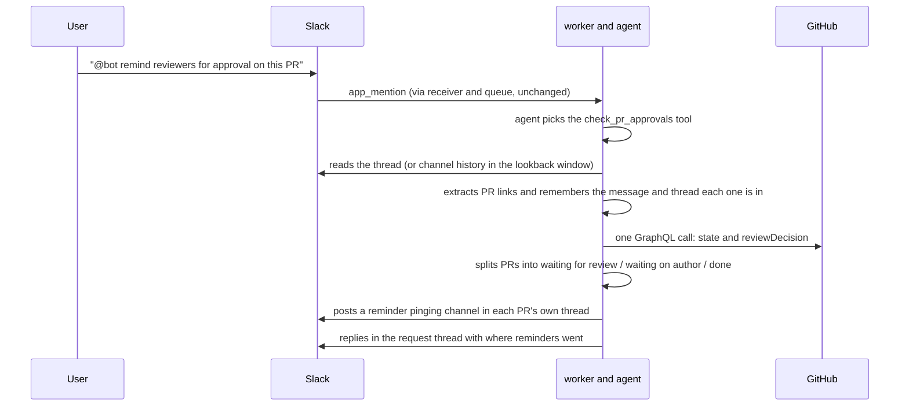
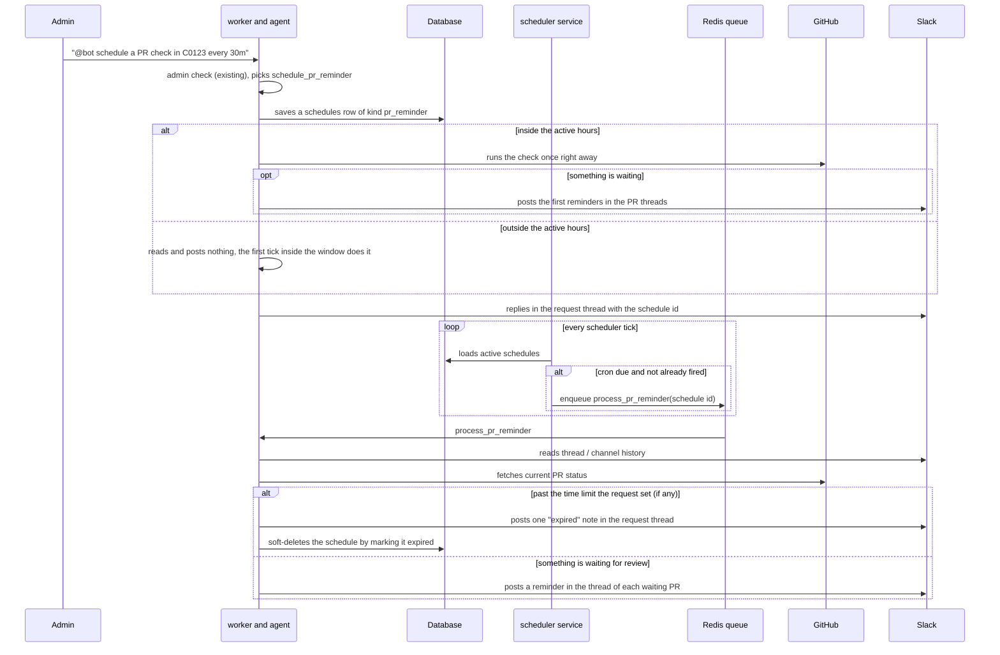
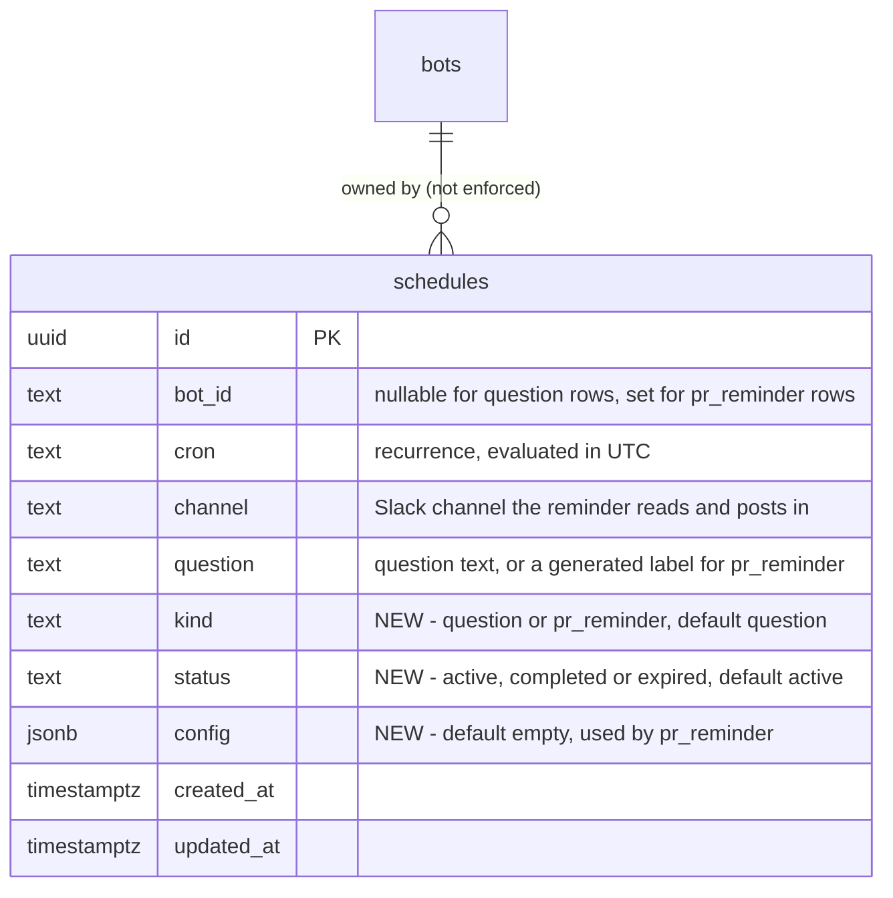

# **PR Review Reminders**

*Ask the bot to check whether pull requests shared in Slack are approved, and to remind the people who haven't reviewed — once, or on a recurring schedule that runs until it is removed (or until a time limit the requester sets)*

| Authors | hung@100xteam.ai |
| --- | --- |
| Status | `APPROVED` |
| PRD Link | — |
| Slack | #data-nerd |
| Date | 2026-11-04 |

# **Overview**

PR links get shared in Slack and then sit unreviewed because nobody remembers to chase them. This RFC adds two agent tools. One checks pull requests shared in Slack against GitHub and answers with the ones still waiting for approval, mentioning the people the requester names, in the thread where each PR was shared. The other sets that check up to repeat on a schedule: the bot reminds inside the Slack thread where each PR was shared, posts nothing when there is nothing to say, and keeps running until an admin removes it, or until a time limit the requester asked for.

Example requests:

- `@bot remind reviewers for approval on this PR` (in a thread that contains a PR link)
- `@bot remind reviewers for approval on PRs in this channel in the last 3d`
- `@bot schedule a task to check PR approval in channel C0123456789 every 30m`

The people to remind are the ones @mentioned in the request. If nobody is mentioned, the agent asks who to remind before doing anything. There is no default and no `@channel`.

A reminder always goes into the thread where the PR link was shared, so the nudge sits next to the PR's own discussion:

1. **Inside a thread that already contains PR links.** The bot checks every PR in that thread and reminds in that same thread.
2. **A top-level message that holds a PR link, or a channel-wide request.** The bot replies to the message that contains the link, which starts a thread on it (or continues the one that exists). In a channel-wide request, that can be several threads. A PR link typed in the request itself is reminded in the request's own thread, which Slack already creates for the mention (the worker uses the message `ts` as `thread_ts`).

The thread the request was made in also gets a short confirmation listing where reminders went.

This document describes the approved design. It is implemented on the `hungnguyen/pr-reminder` branch and not yet deployed.

# **Business Impact**

- Shortens PR review turnaround without a person acting as the chaser; the right people are pinged where the PR was shared.
- Removes manual "any update on this PR?" follow-ups.
- A recurring reminder cleans up after itself: it posts only while something is waiting, ends when everything is approved, and costs no LLM calls.

# **Goals**

- Check one PR, every PR in a thread, or every PR shared in a channel over a lookback window, and report which are still waiting for approval.
- Remind the people named in the request by @mention, and ask who when no one is named.
- Remind inside the thread where each PR was shared, never as a new top-level message.
- Repeat the check on a schedule.
- Run until an admin removes the schedule, and end it automatically only when the requester asked for a time limit (`expires_in_hours`).
- Judge "approved" the way GitHub's Merge button does.

## Non-goals

- Approving, merging, closing or commenting on PRs. The bot is read-only toward GitHub.
- Reading channels on behalf of a one-off request other than the one it was made in.
- Working out who owes a review from the PR itself (its requested reviewers). That would need a GitHub-to-Slack user mapping, and is a possible follow-up.

# **Requirements**

- The GitHub credentials (App installation or PAT) define which repos the bot can read. A PR it can't see is reported as "can't access" with its link only.
- "Approved" is GitHub's `reviewDecision`: `APPROVED` is approved, `REVIEW_REQUIRED` is waiting for review, `CHANGES_REQUESTED` is waiting on the author (noted, no ping). Merged, closed and draft PRs are ignored.
- If a repo has no required-review rule, `reviewDecision` is null. The bot then looks at each reviewer's latest review: at least one `APPROVED` and no `CHANGES_REQUESTED` counts as approved; any `CHANGES_REQUESTED` means waiting on the author; otherwise it is waiting for review.
- A one-off check only reads the channel it was asked in (the tool takes no channel argument), so a request in one channel can't pull another channel's messages into the reply.
- A reminder needs at least one person to remind. When a request names nobody, the tool refuses with "Who should I remind?" before reading Slack or GitHub, and the agent asks the user.
- The only mentions a reminder can contain are Slack user IDs that passed validation: `<@U01ABCDEF>`, `<@U01ABCDEF|name>` or a bare `U01ABCDEF` (at least 9 characters, so a word like `UNKNOWN` or `WHO` is not an ID), at most 10 distinct people. A model that sends the mentions as one string instead of a list is understood too. `@channel`, `@here`, `@everyone`, user groups and anything else are rejected, so the bot can't be used to broadcast. Nothing from Slack messages or GitHub becomes a mention.
- Text from GitHub (PR titles) is escaped (`&`, `<`, `>`) before it goes into a message, so a title can't smuggle in a mention such as `<!channel>` or a fake link.
- Creating a recurring reminder is governed by the existing schedule rule: `bot.admin_users` only. A one-off check is open to anyone who can mention the bot.
- A reminder is posted as a reply in the thread of the Slack message that holds the PR link, never as a new top-level message. PRs that share a thread get one message. If a PR is linked in several messages, the most recent one is used.
- A recurring reminder shows only its schedule id as the way to turn it off, and posts nothing on a run where there is nothing to report.
- Recurring reminders only post between 07:00 and 22:00 Vietnam time (UTC+7; the end is exclusive, so the last tick is before 22:00), and say so in the message. A tick outside that window does nothing and does not end the reminder. The rule gates the recurring reminder: its ticks, and the first check when a schedule is created, which waits for the first tick inside the window if the schedule is created at night. A user's own one-off `check_pr_approvals` request runs at any hour.
- Repeating a request doesn't create a second reminder. An active reminder on the same watched channel with the same scope and the same set of people (and, for thread scope, the same thread) is the same job: the tool returns its id, and says how to change it if the cron differs, without scanning, posting or saving anything. The cron and lookback are not part of the identity, so a different cron means "remove it and set it up again", not a second reminder with the same people. The check runs in the same locked transaction as the quota, so two simultaneous requests can't both create it, and an existing reminder is returned even when the quota is full.
- A recurring reminder is created even when nothing is waiting yet, since a PR can be shared later. It runs until an admin removes it by schedule id: "nothing is waiting" never ends it, because new PRs keep being shared. It ends by itself only when the request set a time limit (`expires_in_hours`, stored as `config.expires_at`), when its channel becomes unreadable, or when its `config` is malformed. The per-channel cap keeps permanent reminders from piling up.
- A report or a stop never treats "nothing found" as "nothing waiting" when the check was incomplete: PRs left unchecked, PRs GitHub couldn't return, or a Slack scan cut short by its message cap all make the result inconclusive.
- A transient GitHub or Slack failure on one run must not end the reminder; the next tick tries again.
- Limits: 14 days of lookback, 1,000 channel messages scanned, 100 PRs checked and 25 threads reminded per run; recurring reminders run at most every 30 minutes and at most 5 may be active per channel.
- Link parsing, status bucketing, message rendering and config validation are pure functions that can be tested without any service.

# Solution

## High-Level Flow

### One-off check



### Recurring reminder



## Entry Points — Two Agent Tools

### `check_pr_approvals` (one-off)

A new tool in a new `pr_reminder` category (`AgentTool.category`), added to `AgentConfigs.TOOLS` and routed from `dispatch_tool()` in `src/agent/dispatch.py` to `dispatch_pr_reminder_tool()`. Anyone who can mention the bot may use it.

| Argument | Meaning |
| --- | --- |
| `scope` | `thread` (the thread the request is in, plus any links in the request) or `channel` (top-level messages in this channel within the lookback). |
| `lookback_hours` | Channel scope only. Default 72, maximum 336. |
| `pr_urls` | PR links typed in the request itself. |

The tool posts the reminders itself, one message per thread, so the mentions and the links are exactly as rendered by code and not paraphrased by the LLM. It returns a short summary to the agent (for example `Reminded in 3 threads: <permalinks>`, or "all 4 PRs are approved or closed"), which the agent relays as the confirmation in the request thread. No change to the agent loop is needed, because the result is always non-empty text.

### `schedule_pr_reminder` (recurring)

A second tool, in the existing `schedule` category so `dispatch_tool()` applies the existing `bot.admin_users` check before it runs. It takes the same arguments as above plus `cron` (UTC, same convention as `add_schedule`) and an optional `channel` (default: the channel of the request; the bot must be a member of it). It:

1. Validates the cron and the limits above.
2. Inserts a `schedules` row with `kind = 'pr_reminder'` (see Database Schema), recording the request's channel and thread as the *origin thread*, unless the same reminder already exists (see Requirements). The row goes in first so the schedule id shown in the first reminders is always real.
3. Inside the active hours, runs the check once immediately, so the admin gets feedback and the first reminders right away. Outside them it reads and posts nothing and says the first check waits for the first tick inside the window. The schedule is kept even if nothing is waiting or no PR links exist yet, because a PR can be shared later; only a failed first check removes the row again. The reply gives the schedule id and says what happened, and never claims nothing is waiting after an incomplete check (unreadable or unchecked PRs, a truncated scan).

To turn a reminder off by hand, an admin asks the bot to remove the schedule; `remove_schedule` already works by id. `list_schedules` shows active reminders too.

A new skill, `13_pr_reminders.md` (`always: false`, description starting "Use when the user asks to check or remind reviewers about pull request approvals, or to schedule recurring PR review reminders"), tells the model when to pick `thread` or `channel` scope, to pass the people the user @mentioned as `mentions` (never the bot itself, never invented IDs) and to ask who to remind when nobody was named, and that a recurring reminder is created with `schedule_pr_reminder`, not `add_schedule`. `.claude/rules/skills.md` and `architecture.md` are updated for the new skill and tool category.

## Collecting PR Links

- **Thread scope.** `conversations.replies` on the thread. In a top-level message there is nothing to scan, so only `pr_urls` from the request are checked.
- **Channel scope.** `conversations.history` with `oldest = now - lookback_hours`, paginated, up to 1,000 messages. Top-level messages only in v1, which the tool description says. If the window holds more messages than the cap, the scan is flagged as truncated.
- **What counts as a link.** A regex for `https://github.com/<owner>/<repo>/pull/<number>` run over message `text`, and also over attachments (`title_link`, `from_url`, `original_url`) and `blocks`. This matters because the GitHub Slack app posts PR notifications as attachments whose `text` can be empty. Slack's `<url|label>` wrapping is handled.
- **Own messages are skipped.** The bot's earlier reminders contain PR links, so messages from the bot are ignored; otherwise its own reminders would keep PRs "alive" in the window.
- **Where each link lives.** Every link keeps the message it was found in, as `(channel, message ts, thread ts)`. The thread to remind in is the message's own `thread_ts` if it has one, otherwise the message's `ts`, since replying to a top-level message starts a thread on it. A link typed in the request itself lives in the request's thread. If a PR appears in several messages, the most recent one wins, so the reminder lands in the thread that is probably still active.
- **Result.** A de-duplicated list of PRs, each with its target thread. The 100 most recently mentioned are checked; the rest are counted, reported in a one-off summary, and are reported in the one-off summary as an incomplete check.

## Checking PR Status

A new generic GitHub primitive in `connectors/github.py`, `graphql(query, variables)`. The existing helpers are hard-wired to `GithubConfigs.OWNER/REPO` through `GithubConfigs.API`; the new one takes the repo from the caller, and the access-control PR flow keeps working untouched. The connector returns raw fields and decides nothing.

One batched query (repository and PR aliases) fetches, per PR: `url`, `title`, `state`, `isDraft`, `reviewDecision`, `createdAt`, `author.login` and `latestOpinionatedReviews` (state and author, for the null-`reviewDecision` fallback and the "changes requested" note).

A pure function in `agent/pr_reminders/status.py` maps each PR to one bucket:

| GitHub state | Bucket | Pings the mentioned people? |
| --- | --- | --- |
| `MERGED` / `CLOSED` | done (ignored) | no |
| draft | skipped | no |
| `APPROVED` | approved | no |
| `CHANGES_REQUESTED` | waiting on author | no (listed only) |
| `REVIEW_REQUIRED` | waiting for review | yes |
| null decision, fallback rule says not approved | waiting for review | yes |
| not visible to the token (404) | can't access | no (listed once, link only) |

"Nothing is waiting" means no PR in the *waiting for review* bucket, and it only counts as *proven* when the check was complete: every linked PR was checked, none was unreadable, and the Slack scan wasn't cut short. A PR waiting on the author doesn't keep a reminder alive.

When `reviewDecision` is null, the fallback reads each reviewer's latest review, up to 20. A visible "changes requested" decides first: the PR waits on the author however many more reviews exist. Otherwise, if GitHub reports more reviews than were fetched, the PR is treated as waiting for review rather than approved, since a hidden "changes requested" can't be ruled out.

## Who Gets Reminded

The people named in the request, by @mention. The model passes their Slack user IDs in the tools' `mentions` argument; the tool validates them (see Requirements), and a recurring reminder stores them in `config.mentions` so every tick pings the same people.

If the request names nobody, the tool refuses with "Who should I remind?" without touching Slack or GitHub, and the skill tells the agent to ask the user and wait. The bot's own mention is never part of the list.

Every reminder message that lists a PR waiting for review starts with the mentions, and nothing else is pinged. The reminder does not name reviewers; it only says which PRs are waiting and for how long. A note about a PR waiting on the author carries no ping. Individual mentions in a thread reply notify the people mentioned, which is the reason for using them instead of a channel-wide ping.

## Reminder Message

Waiting PRs are grouped by target thread, and each thread gets one message, rendered by `agent/pr_reminders/message.py` and split with `slack.split_message`. The wording is not in that module: every phrase, the four rotating headers and the age thresholds that pick a quip live in the `ReminderMessages` config class in `common/configs.py`, so changing the tone or translating the bot means editing that class only, and `message.py` just picks and fills in the templates. The thread already shows the link, so the message stays short. It is written in Vietnamese, in a cheerful, comedic voice (a light nod to Vietnamese stage comedy, with common catchphrases, no quotes from anyone and no names), and it matches the bot's `:pepe-pray:` thinking animation:

```
<@U0123ABC> <@U0456DEF> :eyes: Ủa alo, 3 cái PR này đang chờ review nè bà con ơi! :pepe-pray:
• <https://github.com/org/repo/pull/123|org/repo#123 Fix retry logic> — chờ 20 phút :sparkles: mới tinh
• <https://github.com/org/repo/pull/130|org/repo#130 Add metric view> — chờ 6 giờ
• <https://github.com/org/repo/pull/98|org/repo#98 Refactor loader> — chờ 4 ngày :cricket: dế gáy rồi nha
```

- **Rotating header.** The first line rotates through four phrasings every 30 minutes, so a recurring reminder doesn't repeat itself word for word: `:eyes:` "Ủa alo, … đang chờ review nè bà con ơi!", `:bell:` "Dạ thưa quý vị, … chờ review lâu quá trời quá đất luôn rồi nha!", `:wave:` "Cốc cốc cốc! Có ai ở nhà không? … đang đứng đợi review nè!", `:mag:` "Trời ơi tin được không? … vẫn chưa ai review luôn á!". It is chosen from the clock, not at random, so a given half hour always reads the same. It says "cái PR này" for one PR and "N cái PR này" for several, and capitalises the PR phrase where it starts a sentence.
- **Age.** Each PR line says how long it has waited ("chờ 20 phút", "6 giờ", "4 ngày") with a quip: `:sparkles: mới tinh` under an hour, nothing up to three days, `:cricket: dế gáy rồi nha` from three days, `:spider_web: nhện giăng tơ luôn rồi` from a week.
- **Author's court.** A PR waiting on the author is listed without a ping under "Bóng đang ở sân tác giả (cần sửa lại) :tennis:", or under ":tennis: PR này bị yêu cầu sửa lại, bóng đang ở sân tác giả nha" when it is the only news in the thread.
- **Footer.** A recurring reminder ends with one line: `Lịch nhắc 3f2a…c9 — nhắn "xoá lịch nhắc 3f2a…c9" để tui hết làm phiền nha. Tui chỉ nhắc từ 07:00–22:00 giờ Việt Nam (UTC+7) thôi, tối còn đi ngủ :zzz:`. That id is the only thing about the schedule shown in a PR thread; there is no "Scheduled question" header and no summary. The `schedules` skill tells the agent that "xoá lịch nhắc <id>" means `remove_schedule`.

The notes posted in the origin thread share the voice:
- expired (only for a reminder created with a time limit): `:hourglass: Lịch nhắc 3f2a…c9 đã hết hạn như cả nhà đặt, tui xin phép nghỉ ngơi nha. Cần nhắc tiếp thì kêu tui lập lịch mới!`
- unreadable channel: `:warning: Ủa, tui không thấy channel của lịch nhắc 3f2a…c9 nữa (lỗi Slack: not_in_channel), nên tui treo giày nghỉ nhắc luôn. Kiểm tra giúp tui coi tui còn ở trong channel và có quyền đọc lịch sử (history scopes) không nha.`

Only what the code posts to Slack is Vietnamese. The tool descriptions, the summaries returned to the agent (`active_hours_text()` stays English) and the skill files stay in English; the agent replies in the language the user wrote in. The language is fixed for every bot; a per-bot setting would be the next step if a bot serves a team that doesn't read Vietnamese.

When nothing is waiting, the one-off tool says so in its summary ("Nothing is waiting for review :white_check_mark:"), which the agent relays, and a recurring reminder simply stays quiet and keeps watching. PRs that get approved simply stop appearing in their thread's reminders, so each thread goes quiet as soon as its PRs are done.

## Recurring Reminders

- **Storage.** A row in the existing `schedules` table with `kind = 'pr_reminder'`. The generic columns (`bot_id`, `cron`, `channel`) are used as they are; the settings live in a new `config jsonb` column. `question`, which is `NOT NULL`, holds a short label generated by code (for example `PR review reminder · channel scope, last 72h`), so `list_schedules` stays readable. It is never sent to an LLM for this kind.
- **Scheduler.** `scheduler/app.py` already loads every schedule on each tick. It now loads only `status = 'active'` rows and picks the job by `kind`: `process_scheduled_question` for `question` (unchanged) and `process_pr_reminder(schedule_id, bot_id)` for `pr_reminder`. It never calls GitHub or Slack, preserving the service boundary. A reminder's dedup key is `scheduler:last_fired:{sha256[:16]}` of `pr_reminder:{id}:{cron}`, the existing Redis key pattern, so the key table in `architecture.md` needs no new entry. Question schedules keep their existing key, so shipping this can't change any existing schedule's key and double-fire it.
- **Worker task.** `process_pr_reminder` is a thin shell over `agent/pr_reminders/service.py`. It loads the row and the bot and does nothing if the row is no longer `active`. If the reminder has a time limit (`config.expires_at`) and it has passed, it posts one "expired" note in the origin thread and sets `status = expired`. Otherwise it collects PRs, checks them and posts a reminder in each waiting PR's thread, or nothing when none is waiting. No LLM is involved, so a run costs one Slack read, one GitHub call and one Slack post per thread that has waiting PRs.
- **Where it posts.** Reminders go in the thread of the message that holds each PR link (see Collecting PR Links), so they are always replies and never new top-level messages. Only two things go to the *origin thread*, the request thread stored in `config.origin_channel` and `config.origin_thread_ts`: the schedule id at creation and the closing or expiry note. That matters when the reminder watches a different channel from the one the admin asked in, since there is no single thread to close out in the watched channel. A mention inside a thread reply still notifies the person.
- **Scope on each run.** `thread` scope rescans the origin thread, so PR links added to it later are picked up; the schedule's `channel` must be the origin channel. `channel` scope rescans the lookback window, which slides; a PR that ages out of the window stops being tracked.
- **Stopping.** A reminder has no end of its own: with no `expires_in_hours` in the request it runs until an admin removes it with the existing `remove_schedule`, which deletes the row. Nothing waiting, or never having had anything to remind about, doesn't end it, and neither does an incomplete check. The automatic stops are soft deletes (the row stays and the scheduler no longer loads it): `status = expired` once `config.expires_at` has passed, and `completed` for a permanent problem (see Failures). `expires_in_hours` is passed by the agent only when the user explicitly asks for a time limit ("for 72h"); a lookback window ("PRs in the last 3d") is not one.
- **Failures.** Reminder jobs are not retried by RQ: a run posts before it saves its progress, so a retry after a late failure would repeat the mentions. A transient GitHub error, or a Slack error while reading, fails the job; the reminder stays `active` and the next tick is the retry. A Slack error while posting (a refusal, a timeout or a dropped connection) is only a failed post for that thread, logged and skipped, and does not count as having reminded. If the first check at scheduling time posts reminders and then fails to save its progress, the schedule is kept (the reminders name it) and the reply says the next run may remind those threads again; only a failure before anything is posted removes the row. A permanent problem, such as `not_in_channel`, `missing_scope` or a malformed `config`, is posted back to the origin thread when possible, logged, and ends the reminder (`status = completed`) rather than failing every tick.
- **Active hours.** `run_reminder` first checks the clock (`limits.is_within_active_hours`, a fixed UTC+7 offset since Vietnam has no DST, constants in `AgentConfigs`) and returns at once outside 07:00–22:00: no Slack read, no GitHub call, no post, no status change. A time limit keeps counting, so a reminder can expire overnight; the expiry note is posted on the first tick back inside the window. The one-off tool never consults the clock; the first check of `schedule_pr_reminder` does, as above.
- **Limits.** Minimum interval 30 minutes, checked exactly: the minutes and hours the cron expands to give the shortest gap within a day, and the days it is eligible on over the next two years give the gap across midnight, so `0,40 0,2,23 * * *` (23:40, then 00:00) is rejected while the same times on Mondays only are not. A time limit is optional, comes from the request (stored as `config.expires_at`) and is at most one year (`PR_REMINDER_MAX_EXPIRY_HOURS`), so an absurd value is refused instead of overflowing. At most 5 active reminders per channel, enforced by counting and inserting in one transaction under a Postgres advisory lock on (bot, channel), so concurrent requests on different worker replicas can't both pass. The constants are in `AgentConfigs`; the time limit lives in `config`, so no column is needed.

## Changes to Existing Code

- **Mention stripping in the worker.** `reply_to_mention` removed every `<@…>` token from the request before the agent saw it, which would delete the people the requester names. It now removes only the bot's own mention, using the bot's user ID from Slack `auth.test` (cached per token, falling back to the old strip-everything behaviour if the lookup fails). The review-command parser and the other flows only look at the text after the bot mention, so they are unaffected.
- **`connectors/slack.py`:** add `conversations_replies` and `conversations_history` (paginated), a way to look up a message's permalink for the confirmation summary, and `get_bot_user_id` (`auth.test`).
- **`connectors/github.py`:** add `graphql`. No change to existing functions.
- **`connectors/db/schedules.py`:** `Schedule` gains `kind`, `status` and `config`. `get_schedules()` takes optional `kind` and `active_only` arguments, and there are helpers to add a reminder, set `status`, and merge keys into `config`.
- **Existing schedule tools.** `update_schedule` is restricted to `kind = 'question'`, because it could otherwise change a reminder's cron past the minimum-interval check. `remove_schedule` and `list_schedules` work on both kinds, since removing by id and seeing the id are exactly what an admin needs. Behaviour for question schedules does not change.
- **`scheduler/app.py`:** load only `active` rows and branch on `kind`.
- **`common/configs.py`:** the tool entries, `"pr_reminder"` in `AgentTool.category`, the limits as `AgentConfigs` constants, the `ReminderConfig` class (builds and validates the `config` JSON), and the `ReminderMessages` class (the wording of the reminder messages).
- **`agent/dispatch.py`:** one branch for the `pr_reminder` category, and the `schedule`-category branch passes the request's channel and thread to `schedule_pr_reminder`.
- **`src/worker/tasks.py`:** the `process_pr_reminder` task.
- **New `src/agent/pr_reminders/`:** `pr_links.py`, `queries.py`, `status.py`, `message.py` (fills in the templates of `ReminderMessages`), `limits.py` (all pure; `limits.py` has the cron minimum-interval, expiry, active-hours and mention-parsing checks), `service.py` (collect, check, post), `tools.py` (the two tool handlers).
- **New skill file** `13_pr_reminders.md`.
- **Unchanged:** the receiver, the agent loop and `process_scheduled_question`.

# **Database Schema**



Migration `V9__schedules_pr_reminders.sql` adds the three columns to `schedules` with defaults that keep every existing row a live question schedule (`kind = 'question'`, `status = 'active'`, `config = '{}'`), plus check constraints on `kind` and `status`. Existing rows need no backfill, and the existing `schedules_updated_at` trigger already maintains `updated_at`.

| Field | Description |
| --- | --- |
| schedules.kind | Selects the job the scheduler enqueues and which tools may edit the row. |
| schedules.status | `active` rows are picked up by the scheduler; `completed` and `expired` are the automatic soft-delete states. Question schedules stay `active` for good. |
| schedules.config | For `pr_reminder`: `scope` (`thread` or `channel`), `mentions` (Slack user IDs, at least one), `lookback_hours` (channel scope), `origin_channel` and `origin_thread_ts` (the request thread, which gets the schedule id and the closing note and is the thread scanned in `thread` scope), `created_by`, `expires_at` (unix time, only when the request set a time limit) and the progress the job saves as it runs: `last_reminded` (thread key to unix time, so threads take turns). Reminders themselves go to each PR's own thread, which is found on every run, so no target thread is stored. Validated in `common/configs.py`, not by the database. |

# **External Systems Touched**

- **Slack:** new bot scopes `channels:history` and `groups:history` (private channels) for `conversations.history` and `conversations.replies`, so every bot's Slack app must be updated and reinstalled. The bot must be a member of every channel it reads. Confirm each app is an internal (non-distributed) app; Slack applies much stricter history rate limits to distributed apps that aren't in the Marketplace. Also uses `chat.postMessage` (already used) and `chat.getPermalink`. Also `auth.test`, to learn the bot's own user ID.
- **GitHub:** read-only GraphQL on pull requests. The GitHub App needs *Pull requests: Read*, and its installation decides which repos the bot can see, so scope the installation to the repos you want covered (a PAT needs equivalent access). Because any channel member can paste a PR link, a broadly scoped token means the bot may show the title, author and review state of a private PR to people who can't open it on GitHub. Credentials keep coming from env, never Supabase, as for the existing client. `_app_installation_token` caches one installation, so v1 covers repos under a single installation.
- **Supabase:** the three new `schedules` columns.
- **Redis:** the existing queue and the existing `scheduler:last_fired` key pattern. No new keys.

# **Alternatives Considered**

- **Run a recurring check as a plain scheduled question** (the existing `add_schedule`, with the agent calling the one-off tool each run). No schema change, but each run is about three LLM calls, `process_scheduled_question` posts a new top-level "Scheduled question" message and summary every time, a run can't stay quiet, and it has no way to know its own schedule id and stop itself. These are exactly the behaviours this RFC needs, so it was rejected.
- **A separate `pr_reminders` table.** Cleaner columns and database-level constraints (for example a thread-scope row must have a thread), and no `kind` guard on `update_schedule`. It costs a second table, a second scheduler query and a second CRUD module. Rejected in favour of reusing `schedules`; switch to it if more recurring job kinds appear and `config` starts to sprawl.
- **One consolidated reminder thread per reminder** (a single summary of every waiting PR). Fewer posts and a clean place to see everything, but the nudge lands away from the PR's own discussion, which is where reviewers will see it. Rejected in favour of reminding in each PR's thread.
- **Stop when nothing is waiting for review** (v1 behaviour, with a 7-day lifetime). Dropped: admins want reminders to run permanently, since new PRs keep being shared, and the stop note read as the bot quitting. A time limit is now opt-in per request.
- **GitHub webhooks (or the GitHub Slack app) instead of polling.** Real-time and no Slack history scopes, but it needs a public endpoint with signature checking on the receiver, repo-side config, and doesn't cover "what was posted in the last 3 days". Polling is enough.
- **Only track PRs the bot was mentioned with.** No new Slack scopes, but it breaks the "PRs in this channel" request.
- **Approval = at least one approving review.** Ignores required reviewer counts and CODEOWNERS, so the bot could call a PR approved while the Merge button is still blocked.

# **Rollout Plan**

1. Merge the migration (`V9`), then apply it with a `db-dev-v…` tag, then `db-staging-v…`, per the deployment notes in `CLAUDE.md`. It is safe ahead of the code: the new columns have defaults, and the old scheduler and tools ignore them.
2. Add the Slack scopes and reinstall the dev bot's app; make sure the GitHub App or PAT can read the repos you want covered, and no more.
3. Ship the code with an `agentic-slack-bot-v…` tag. No new environment variables, so `ansible-infra` needs no change. Skills are baked into the image, so the new skill file only reaches deployed environments with this tag. Don't create a reminder until the scheduler and worker both run the new image: an old scheduler would enqueue a `pr_reminder` row as a scheduled question. They ship in the same image and rollout, so this only matters if a deploy is split.
4. Try the three example requests in a dev channel, then repeat for the other bots. A bot without the history scopes gets a clear error from the tool, so enabling bots one at a time is safe.

# **Testing**

Tests mirror `src/` under `tests/`. Pure modules get table-driven tests: link extraction (plain, `<url|label>`, attachment-only, duplicates, non-PR GitHub links, other hosts, the bot's own messages), status bucketing for every row of the table above including null `reviewDecision`, message rendering and escaping (a title containing `<!channel>` or `<@U1>` stays inert, and the only live mentions are the ones passed in), mention parsing (`<@U1>`, `<@U1|name>`, bare `U1`, duplicates, the limit, and rejection of `<!channel>`, `<!here>`, user groups and plain names), the worker's removal of only the bot's own mention, and `config` and cron validation (minimum interval, expiry, per-channel cap).

The tool handlers and `process_pr_reminder` are tested with Slack, GitHub and Supabase mocked at the boundary (`autospec=True`):
- non-admin refused by `schedule_pr_reminder`;
- creating a reminder keeps the schedule when nothing is waiting or no PR links exist yet, and removes it only if the first check fails;
- a reminder that has never delivered a reminder keeps watching, remembers when it first does (a run whose posts all failed doesn't count), and only then can end;
- creating a reminder at night keeps the schedule but reads and posts nothing; a one-off check at night still runs;
- a cron whose shortest gap is across midnight, an absurdly long PR number, and the per-channel quota under concurrency are each covered by their own tests;
- an incomplete check (unchecked PRs, an unreadable PR, a truncated Slack scan) never produces an all-clear in the one-off summary, and a recurring reminder is never ended by a check;
- with more waiting threads than fit in one run, the next tick reminds the threads that were left out first;
- a run with waiting PRs posts one reply per target thread (PRs sharing a thread get one message), never a top-level message, and the thread of a PR linked in several messages is the most recent one;
- a PR linked in a top-level message is reminded in a thread on that message, and one linked in a reply in that reply's thread;
- a run with nothing waiting posts nothing and leaves the reminder `active`, however many times it has already reminded;
- a reminder without a time limit never expires, however old; one past its `expires_at` posts the expiry note and sets `expired`;
- a transient GitHub error leaves the row `active`; `not_in_channel` ends it with a note;
- a 404 is listed as "can't access" without leaking details.

Regression tests for the shared table: the scheduler enqueues the right job per `kind` and skips non-`active` rows, and `update_schedule` ignores `pr_reminder` rows by id while `remove_schedule` still deletes one.
# **Discussions**

- **Many threads means many posts.** A run posts one message per thread with waiting PRs, at most 25 threads. When more wait than fit, the threads reminded longest ago (or never) go first, using the per-thread times in `config.last_reminded`, so they take turns across ticks; threads waiting for review come before author-only ones, and ties go to the oldest PR. The rest are counted as deferred. A thread reminded less than half the minimum interval ago (15 minutes) is skipped, so a tick the scheduler fires seconds after the first check, which happens when a reminder is created just after a cron boundary, doesn't repeat it; a normal tick, a full interval later, is unaffected. Slack allows about one message per second per channel; the poster honours `Retry-After` on a 429 and spaces posts out. Even at the 30-minute minimum, many unapproved PRs means a lot of nudging, which is the main argument for the escalation cap below.
- **The request thread gets a confirmation, so it can look doubled.** When the PR link lives in the request's own thread, that thread gets the reminder and the agent's short confirmation. Acceptable for v1; the tool could skip the confirmation in that case.
- **A thread the bot can't post in.** Archived channels, deleted parent messages and threads in channels the bot has left fail per thread. The run logs it, carries on with the other threads and doesn't end the reminder; only a channel-wide `not_in_channel` ends it.
- **"Nothing waiting" is not an all-clear for the one-off tool when the check was incomplete.** Unchecked PRs, unreadable PRs and a truncated Slack scan make its summary say it can't confirm. A recurring reminder is unaffected: it never ends on a check, so a PR that ages out of a channel-scope lookback window just stops being tracked.
- **Channel scope only scans top-level messages.** A PR link posted inside a thread reply is missed, and a recurring reminder that only sees such PRs never starts. The tool description says top-level only. Adding replies costs one `conversations.replies` call per active thread and is the first thing to hit Slack rate limits. Worth doing if people paste PRs into threads.
- **Anyone can trigger a one-off reminder for anyone.** A user can have the bot mention up to 10 people per request, and nothing rate-limits one-off checks. The 30-minute minimum caps recurring reminders, but a short per-thread cooldown on one-off checks (a Redis key, which would need a row in the key table in `architecture.md`) would stop mention spam. Add it if misuse shows up.
- **Working hours are fixed.** Recurring reminders post 07:00–22:00 Vietnam time only, the same for every bot, channel and reminder. There are no per-reminder hours, no timezone setting, and weekends and public holidays are not skipped. A per-reminder `active_hours` in `config`, or a timezone per bot, would be the next step if teams in other timezones use this.
- **Escalation.** Re-pinging every few minutes until approval can be annoying. A per-reminder cap on posts, or backing off after N reminders, can be added later; with no time limit, removing the schedule is the only brake today.
- **People are named by hand.** The requester has to @mention everyone, every time. Working out who owes a review needs the PR's requested reviewers mapped from GitHub logins to Slack users (a `github_slack_users` table per bot, or a "link my GitHub account" tool with verification).
- **`config` is unchecked by the database.** A malformed row is caught only by the code that wrote it, so `process_pr_reminder` treats it as a permanent error and ends the reminder. The `question` column also holds a generated label for this kind, which is a small abuse of its meaning.
- **Multiple GitHub installations** (repos in more than one org) are unsupported by the current token cache.
